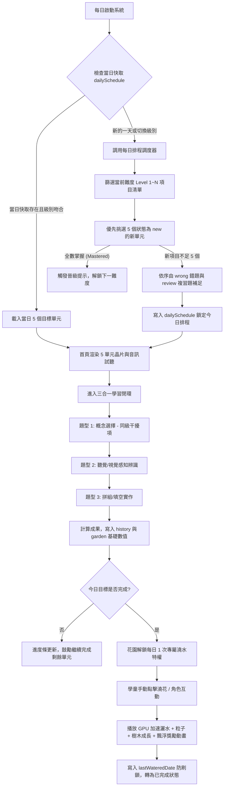

# 🏗️ 通用微學習與遊戲化成長架構規劃書 (Micro-Learning & Gamification Architecture Blueprint)

> 本架構為一套**完全本地化（Zero-Server）、階梯式認知分級、每日冪等排程、多模態評量與正向遊戲化閉環**的通用微學習系統設計規範。
> 可直接套用於：**多國語言單字（英/日/韓/西）、數學公式/九九乘法、程式語言語法（Python/JS/SQL）、各類考照題庫（醫學/法律/證照）與企業 SOP 培訓**。

---

## 一、 系統架構圖 (System Architecture)

```mermaid
graph TD
    subgraph Client [用戶端執行環境 (完全離線 / 瀏覽器執行)]
        subgraph Storage [持久化儲存 (LocalStorage)]
            DB[(本地快取)]
            Prof[使用者檔案與等級]
            Sched[每日排程快取 YYYY-MM-DD]
            Stats[單元學習統計歷程]
            Garden[成長數值與澆水鎖]
        end

        subgraph CoreEngine [核心業務引擎 (Core Engine)]
            Curriculum[認知分級引擎 (Curriculum)]
            DailySched[每日排程調度器 (Scheduler)]
            QuizGen[多模態評量出題器 (Quiz Engine)]
            RewardSys[遊戲化與習慣閉環 (Reward System)]
        end

        subgraph UI [使用者介面層 (Generative UI)]
            HomeView[首頁: 今日推薦 5 單元 + 試聽]
            LearnView[學習閉環: 選擇 ➔ 感知 ➔ 拼組]
            GardenView[花園/角色: 每日 1 次專屬澆水動畫]
            WordView[知識庫: 交叉分級篩選與檢索]
            ReportView[報告: 7 日趨勢與薄弱項分析]
        end
    end

    Curriculum --> DailySched
    DailySched --> Sched
    Sched --> HomeView
    HomeView --> LearnView
    LearnView --> Stats
    Stats --> RewardSys
    RewardSys --> Garden
    Garden --> GardenView
```

---

## 二、 核心工作流程 (Workflow Pipeline)



---

## 三、 Agent 職責分工契約 (Multi-Agent Contracts)

| Agent 角色 | 職責定義 (Responsibilities) | 輸入 (Inputs) | 輸出合約 (Outputs) |
| :--- | :--- | :--- | :--- |
| **Curriculum Planner Agent** | 課綱難度分階、題量平衡（如 300 題拆為 6 級各 50 題）、範疇分類與標籤定義 | 原始題庫、認知教學課綱 | 標註 `level: 1~N`、`category` 的標準 JSON 陣列 |
| **Daily Scheduler Agent** | 依日期與學習進度實現冪等排程，處理新題推薦、錯題回補與全熟晉級 | `currentLevel`, `stats`, `todayKey` | 包含 5 個單元 ID 的不可變陣列 `[id1..id5]` |
| **Adaptive Quiz Agent** | 提取選定單元，自「同級題庫」提取干擾項，混編選擇、感知、實作題型 | 排定的 5 個單元、同級候選池 | 包含 10~15 題的學習會話物件 `currentSession` |
| **Gamification Controller Agent** | 掌管花園階段晉升、成就徽章判定、每日專屬 1 次互動狀態機與粒子時序 | 答題結果、當日完成度、防刷紀錄 | 視覺階段（種子/樹苗/大樹）、解鎖獎勵、動畫控制訊號 |
| **Local State Agent** | 處理 LocalStorage 容錯讀寫、型別強轉、版本遷移與備份 JSON 匯入匯出 | 瀏覽器事件、檔案上傳 | 冪等本地資料庫、資料完整性保證 |

---

## 四、 通用資料結構架構 (Generic Data Schema)

### 1. 通用知識庫結構 (`items.json`)
```typescript
interface UniversalKnowledgeItem {
  id: number;                // 唯一識別碼 (1 ~ Total)
  key: string;               // 學習主體 (單字 / 韓日文 / 程式函式 / 數學公式)
  meaning: string;           // 說明 / 中文釋義 / 解法
  category: string;          // 領域分類 (如: "代數", "基本動詞", "迴圈控制")
  icon: string;              // 視覺圖示 / Emoji
  level: number;             // 難度等級 (1 ~ 6 級)
  metadata?: {
    phonetic?: string;       // 發音標記 / 音標
    example?: string;        // 範例句子 / 範例程式碼
    hint?: string;           // 記憶提示 / 口訣
  };
}
```

### 2. 使用者學習狀態儲存規格 (`localStorage["appStorageKey"]`)
```typescript
interface AppLocalStorage {
  version: "1.2";
  student: {
    name: string;
    grade: number;           // 當前所選難度等級 (1 ~ 6)
  };
  dailyGoal: number;         // 每日安排數量 (預設 5)
  dailySchedule: {
    [dateKey: string]: number[]; // "2026-09-17": [10, 11, 12, 13, 14]
  };
  words: {
    [id: number]: {
      attempts: number;      // 總作答次數
      correct: number;       // 答對次數
      wrong: number;         // 答錯次數
      lastSeen: string;      // 最後練習日期 YYYY-MM-DD
    };
  };
  history: Array<{
    date: string;            // 練習日期 YYYY-MM-DD
    questions: number;       // 今日作答題數
    correct: number;         // 今日答對題數
    completedWords: number;  // 今日完成單元數
    completed: boolean;      // 今日 5 單元是否達標
  }>;
  garden: {
    flowers: number;         // 累積花朵數
    leaves: number;          // 累積葉片數
    fruits: number;          // 累積果實數
    lastWateredDate: string | null; // 每日專屬澆花日期鎖 ("YYYY-MM-DD")
  };
}
```

---

## 五、 核心排程演算法規範

```javascript
/**
 * 每日冪等排程調度演算法 (Daily Idempotent Scheduler)
 * 保證同日同一難度下刷新頁面，題目始終一致；換日自動更新。
 */
function getTodayAssignedItems(data, ALL_ITEMS, todayKey) {
  const currentLevel = Number(data.student.grade) || 1;
  const levelItems = ALL_ITEMS.filter(item => item.level === currentLevel);

  // 1. 檢查當日快取 (Cache Hit)
  if (data.dailySchedule && data.dailySchedule[todayKey]) {
    const cachedIds = data.dailySchedule[todayKey];
    if (Array.isArray(cachedIds) && cachedIds.length === 5) {
      const cached = cachedIds.map(id => ALL_ITEMS.find(w => w.id === id)).filter(Boolean);
      if (cached.length === 5 && cached.every(w => w.level === currentLevel)) {
        return cached;
      }
    }
  }

  // 2. 狀態分流 (Status Partitioning)
  const getStatus = (id) => {
    const r = data.words[id];
    if (!r || !r.attempts) return "new";
    if (r.wrong > r.correct / 2) return "wrong";
    if (r.correct >= 4 && r.wrong <= 1) return "mastered";
    return "review";
  };

  const fresh = levelItems.filter(w => getStatus(w.id) === "new");
  const wrong = levelItems.filter(w => getStatus(w.id) === "wrong");
  const review = levelItems.filter(w => getStatus(w.id) === "review");
  const mastered = levelItems.filter(w => getStatus(w.id) === "mastered");

  let selected = [];

  // 優先抓取 5 個新單元
  if (fresh.length >= 5) {
    selected = fresh.slice(0, 5);
  } else {
    selected = [...fresh];
    // 依序由錯題補足
    if (selected.length < 5) selected.push(...wrong.slice(0, 5 - selected.length));
    // 仍不足由待複習補足
    if (selected.length < 5) selected.push(...review.slice(0, 5 - selected.length));
    // 仍不足由已掌握補足
    if (selected.length < 5) selected.push(...mastered.slice(0, 5 - selected.length));
  }

  // 3. 寫入快取並持久化
  if (!data.dailySchedule) data.dailySchedule = {};
  data.dailySchedule[todayKey] = selected.map(w => w.id);
  saveData();

  return selected;
}
```

---

## 六、 每日目標後專屬澆花/養成動畫機制

### 1. 三態權限狀態機 (Three-State Gate)
- **State A (Locked 🔒)**：今日未完成 5 個單字 ➔ 按鈕灰階鎖定，點擊提示激勵完成今日進度。
- **State B (Ready 🚿)**：今日已完成 5 個單字且今日未澆水 ➔ 按鈕天藍色漸層 + 呼吸光暈（Pulse），點擊啟動動畫。
- **State C (Done ✨)**：今日已執行過澆水 ➔ 按鈕轉為翡翠綠，標註「今日已完成，明天再來」。

### 2. 動畫編排時序 (Animation Timeline)
```
0.0s ───── 點擊「為花園澆水」，狀態加鎖 isWatering = true，按鈕文字切換「💦 澆水中...」
0.1s ───── 灑水壺現身並旋轉傾斜 (rotate -38deg)
0.2s~0.8s ─ 連續灑落 8 顆靈動水滴粒子 (CSS keyframes dropFall，帶微量水平隨機位移)
0.5s ───── 樹木/角色吸收水分彈跳放大 (scale 1.25) 並發出綠色光暈呼吸特效
1.4s ───── 結算數值 (+1 金花, +5 嫩葉)，紀錄 lastWateredDate = todayKey
1.4s ───── 向上浮動飄起「+1 🌸 金花  +5 🍃 嫩葉」成就浮動膠囊 (floatReward)
1.8s ───── 灑水壺淡出復原，解開 isWatering 鎖，刷新花園各項指標數值
```

---

## 七、 移植其他學科應用指南 (Porting Guide)

| 學習領域 | 知識庫範例 (`key` / `meaning`) | 分級標準 (Level 1~6) | 評量題型調整 | 遊戲化主題置換 |
| :--- | :--- | :--- | :--- | :--- |
| **國小數學** | `7 × 8` / `56` | L1: 2~3段、L2: 4~5段 ... L6: 綜合四則運算 | 1. 算式選答案<br>2. 聽題目心算<br>3. 數字鍵盤拼出答案 | **「積木建造城堡」**<br>每天完成解鎖敲磚建造一層塔樓 |
| **Python 語法** | `len(list)` / `取得清單長度` | L1: 變數型別、L2: 條件判斷 ... L6: 物件與模組 | 1. 程式碼執行結果預測<br>2. 語法功能匹配<br>3. 代碼塊排列拼組 | **「AI 機器人裝甲升級」**<br>每天完成解鎖每日一次充能/安裝裝甲 |
| **日語 50 音/單字** | `ありがとう` / `謝謝` | L1: 清音、L2: 濁音半濁音 ... L6: N5 核心動詞 | 1. 假名選羅馬拼音<br>2. 語音聽辨<br>3. 假名字母拼字 | **「神社繪馬祈福」**<br>每天完成解鎖今日一次敲鐘擊掌祈福 |
| **醫學/解剖專有名詞** | `Cerebellum` / `小腦` | L1: 骨骼系統、L2: 循環系統 ... L6: 神經中樞 | 1. 名詞選功能器官<br>2. 英文發音認讀<br>3. 字母字根拼組 | **「人體機能研究室」**<br>每天完成解鎖細胞活力注入動畫 |

---

## 八、 Cursor Rules (`.cursorrules`)

```markdown
# .cursorrules - Universal Micro-Learning & Gamification Architecture

## Core Architectural Rules
1. Zero-Backend & Zero-CORS: 專案必須保證能在瀏覽器以 `file:///` 協議雙擊離線執行，禁止任何外部伺服器依賴。
2. Idempotent Scheduling: 每日排程必須使用 `YYYY-MM-DD` + `Grade/Level` 快取，同一天重新整理或切換分頁絕不可跳題。
3. Daily Interaction Anti-Abuse: 每日養成動作必須同時滿足 `completedToday === true` 且 `lastWateredDate !== todayKey`，同日嚴格限額 1 次。
4. Defensiveness in Storage: 從 LocalStorage 取出數值時，必須全面使用 `Number(val) || 0` 做型別防禦，杜絕 `[object Object]` 汙染。
5. Pure CSS Keyframe Animation: 粒子與物體形變只使用 GPU 加速屬性（`transform`、`opacity`），粒子生命週期結束必須即時呼叫 `.remove()` 銷毀 DOM。
```

---

## 九、 效能與 Token 成本優化

1. **靜態內嵌免請求**：資料庫以 `const ITEMS = [...]` 內嵌於 JS 檔案內，避免瀏覽器發起 Fetch，既提升載入速度（< 10ms）又免除 CORS 權限問題。
2. **$O(1)$ 冪等查表**：每日排程以日期為鍵只計算一次並記錄陣列 `[id1..id5]`，後續切換頁面或刷新直接查表，不消耗 CPU 與記憶體。
3. **同級干擾項精準抽樣**：選擇題選項從 `level === currentLevel` 候選池中挑選，既具備教育鑑別度，又縮小隨機運算範圍。
4. **DOM 粒子即用即銷**：動畫粒子透過 `setTimeout` 自動移除 DOM 節點，防止長時間運行造成頁面卡頓與記憶體外洩。
